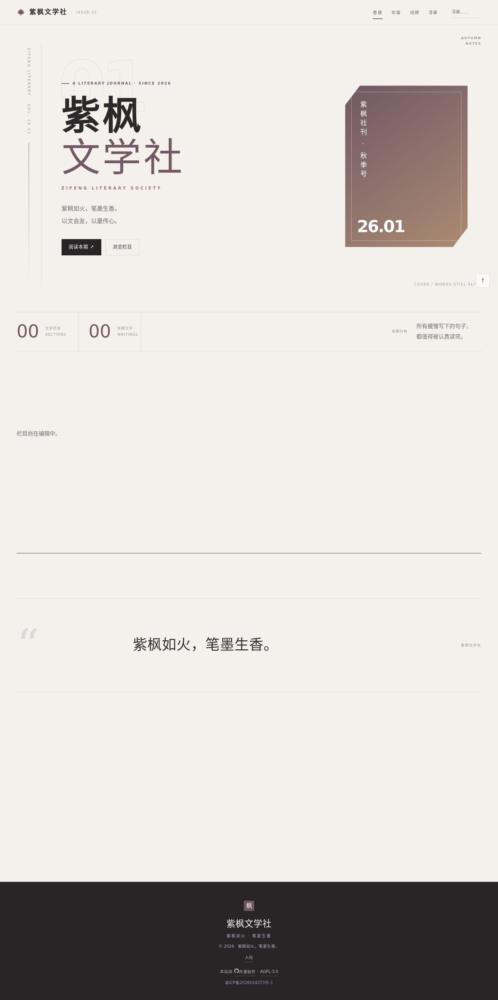
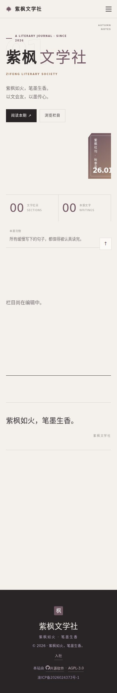
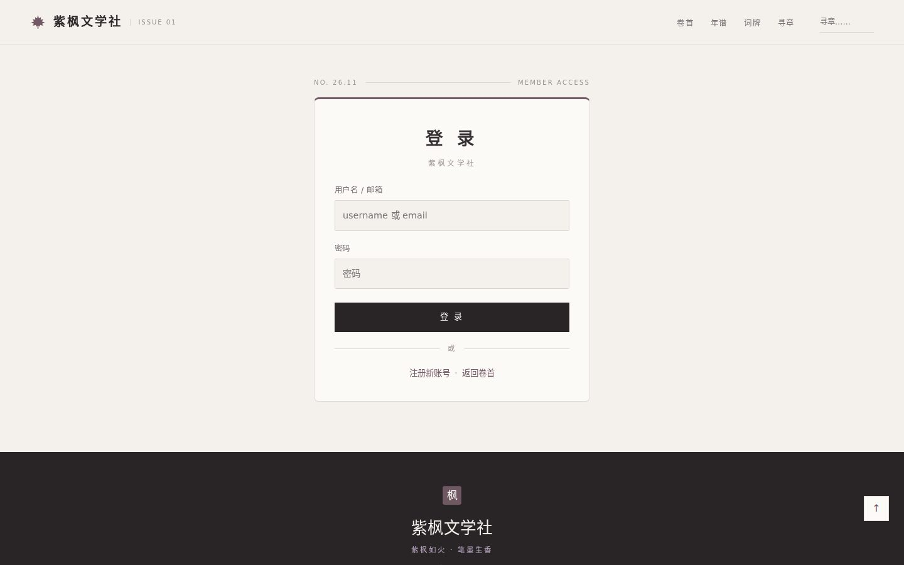
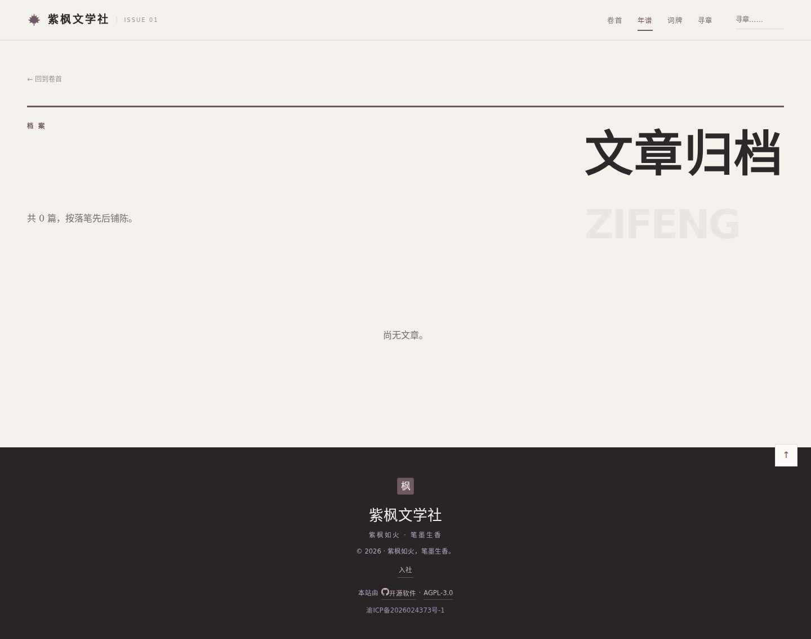

# Zifeng 紫枫

> 为文学社而作的紫调墨韵主题。枫叶作印，暖纸为底，紫墨为字。
>
> `engine_version: 1` · `version: 1.0.0` · `license: AGPL-3.0-or-later`

紫枫把博客当成一本**社刊**来处理：首页重心不是信息流，而是栏目（各自一部文集）、署名与题记。适用于文学社团、编辑部、个人文集类站点。

---

## 截图

**首页 · 桌面端**



**首页 · 移动端**

<p align="center"></p>

**登录页**



**年谱（归档）**



---

## 特性

### 社刊式的版面秩序

- **栏目即文集**：`#portals` 区块把每个 collection 呈现为一部独立自选集，带编号、题记与主笔署名，而不是按标签堆叠的卡片墙。
- **署名块独立**：文章详情页的作者信息做成横向署名条（上下 1px 细线 + 等宽小章「作者」+ 宋体姓名），与日期、阅读数等元数据明确分层。
- **语义锚点完整**：`top` / `portals` / `pinned` / `latest` / `about` / `epigraph` 六个锚点按契约保留，便于外部导航与主题间迁移。

### 紫调墨韵的配色系统

| Token | 亮色 | 暗色 |
|---|---|---|
| `--cinnabar`（朱印） | `#735866` | `#c1a8b5` |
| `--paper-warm`（暖纸） | `#f4f1ec` | `#191618` |
| `--paper-card`（卡纸） | `#fcfaf6` | — |
| `--ink-deep`（深墨） | `#353033` | — |
| `--hairline`（界行） | `rgba(58,44,49,.14)` | — |

契约 tokens 变量全部保留，未删减任何一项；主题私有变量统一加 `--zf-` 前缀（`--zf-maple-grad`、`--zf-display`、`--zf-wide`、`--zf-paper-grain`），不与契约命名空间冲突。

### 夜读模式

深色模式不是简单反色，而是「灯下夜读」：暖纸变为近黑褐 `#191618`，朱印提亮为 `#c1a8b5`，纸纹颗粒（`--zf-paper-grain`）在暗色下关闭，避免噪点干扰。

### 导航与移动端

- 56px 导航高度，`blur(12px) saturate(180%)` 顶栏材质，`blur(16px) saturate(180%)` 菜单面板。
- 菜单展开时对 `#main-content` 做同层 `blur(3px)` 磨砂，不使用独立暗色遮罩。
- 44px 触控目标，两列菜单、6px 间距、14px 边距，200ms 淡入 + `translateY(-8px)` 展开。

### 认证页面

补齐 `login` / `register` / `verify-email` / `logout` / `account` 五个模板，不再回退 classic 的圆角卡片样式。统一为社刊刊头版式：卡片顶部 3px 紫棕实线、宋体 800 字重 `.22em` 字距标题、44px 按钮高度。

### 资源与字体

- 主题自有资源全部放在 `assets/`，通过 Vite import 或相对 `url()` 引用，**不放进 `public/`**。
- 字体只使用系统栈（宋体 / 衬线 / 等宽组合），**不引任何外链字体域**，不会被 CSP 拦成静默回退。

---

## 安装

### 一、通过主题包安装

1. 从本仓库下载 `zifeng.zip`。
2. 在博客后台「主题」页面选择「上传主题」，选入 `zifeng.zip`。
3. 启用主题，或在 `.env` 中设置：

```bash
BLOG_THEME=zifeng
```

4. 重启服务：

```bash
pnpm build && pnpm start
```

### 二、通过源码目录安装

把本主题的整个目录复制到主仓的 `src/themes/zifeng/`，然后同步 `tsconfig.json` 的 `@theme/*` 路径别名（推荐用主仓脚本自动处理）：

```bash
pnpm theme zifeng
```

### 三、环境要求

| 项 | 要求 |
|---|---|
| 主题引擎 | `engine_version: 1` |
| 模板根 | `layouts/BaseLayout.astro` 必须存在（硬必需） |
| 核心模板 | 10 个核心模板全部提供，无回退 |
| 认证模板 | 5 个认证页全部提供 |
| 运行时 | 与主仓一致，Node / Worker 双目标均可 |

### 四、可选配置

主题会消费 `SiteContext` 中的 `SITE_NAME`、`SITE_SLOGAN`、`beianIcp`、`beianMps`、`R2_PUBLIC_URL`。头像走 `R2_PUBLIC_URL` 拼接，未配置时回退站内 `/api/files` 路径。

---

## 许可

**AGPL-3.0-or-later**

```
Zifeng 紫枫 — 为紫枫文学社而作的主题
Copyright (C) 2026 WhiteMoon319

This program is free software: you can redistribute it and/or modify
it under the terms of the GNU Affero General Public License as published
by the Free Software Foundation, either version 3 of the License, or
(at your option) any later version.

This program is distributed in the hope that it will be useful,
but WITHOUT ANY WARRANTY; without even the implied warranty of
MERCHANTABILITY or FITNESS FOR A PARTICULAR PURPOSE.  See the
GNU Affero General Public License for more details.

You should have received a copy of the GNU Affero General Public License
along with this program.  If not, see <https://www.gnu.org/licenses/>.
```

---

## 更新日志

### 1.0.0 — 2026-11-12

首个版本。

- 新增：社刊式首页，栏目呈现为独立文集（`#portals` + 编号 + 题记 + 主笔署名）
- 新增：文章详情页独立作者署名条（`post-byline`），与元数据分层
- 新增：五个认证页模板 `login` / `register` / `verify-email` / `logout` / `account`
- 新增：深色「夜读」配色
- 新增：导航 56px 高度 + 毛玻璃材质 + 同层磨砂（不使用遮罩）
- 新增：页脚用户行分隔符、登录状态徽章、链接可点击态
- 新增：`--zf-*` 私有变量命名空间，与契约 tokens 隔离
- 修订：栏目副标题语义（「各成一部自选集」，不预设数量与体裁）
- 修订：移除 `@core/AuthorByline` 之外的无用 import，保持数据纯净层

---

## 契约符合性声明

本主题按 `docs/THEME_DEVELOPMENT.md` 编写，声明如下：

| 条款 | 状态 |
|---|---|
| `layouts/BaseLayout.astro` 存在 | ✅ |
| 10 个核心模板齐备，无逐文件回退 | ✅ |
| 语义锚点 `top/portals/pinned/latest/about/epigraph` 保留原名 | ✅ |
| tokens 契约变量全覆盖，无删减 | ✅（32 个） |
| 数据纯净层：无 `lib/db`、`lib/auth`、`astro:env`、`node:*`、`cloudflare:*` | ✅ |
| 主题资源放 `assets/`，不进 `public/` | ✅ |
| 无外链字体域 | ✅ |
| 列表卡使用 `<div>` + `@core/CardLink`，不整卡套 `<a>` | ✅ |

已知设计选择：文章详情页的署名区使用主题自有实现（`post.astro` 内的 `.post-byline`）而非 `@core/AuthorByline`，原因是社刊版式需要上下细线、等宽小章与首字圆章兜底头像，核心组件的结构不足以承载。此点已在 PR 描述中声明，供复审判断。
